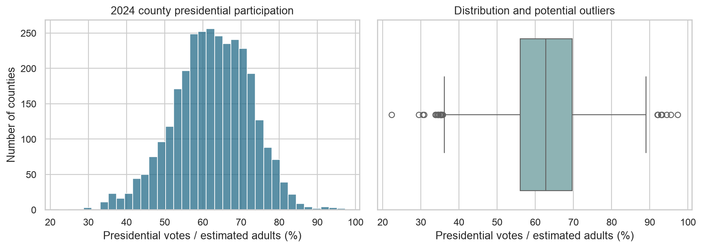
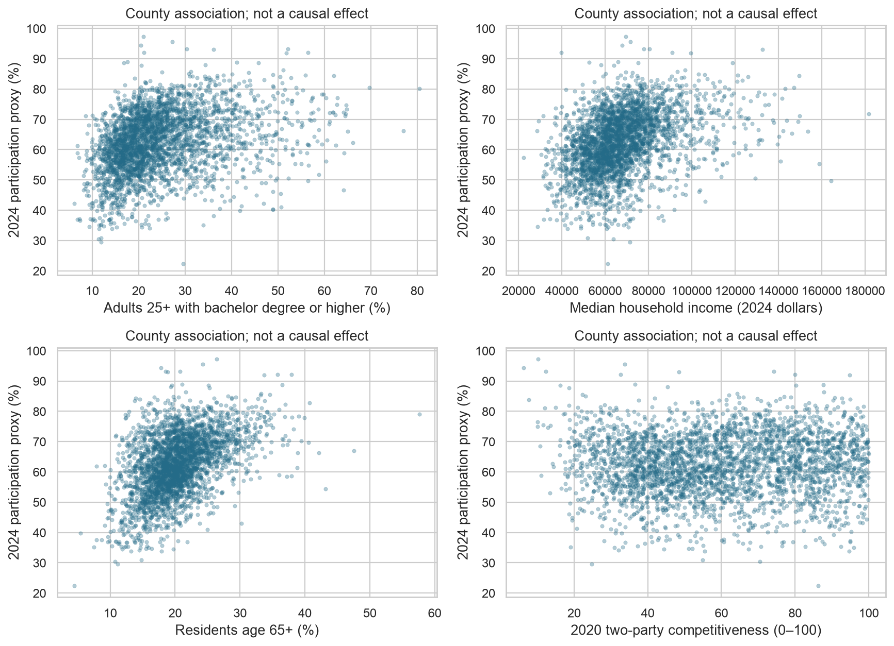
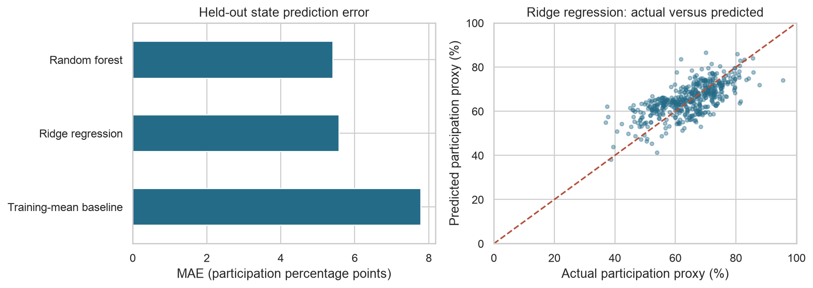
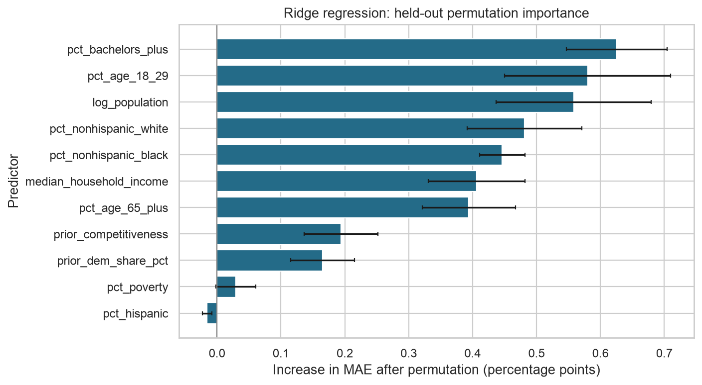

# What Predicts County-Level Presidential Participation?

**Author:** Mikaela Beck  
**Capstone checkpoint:** Module 20 — Initial Report and Exploratory Data Analysis  
**Data retrieved / analysis prepared:** October 28, 2026

## Executive summary

This initial analysis examines 2024 county-level presidential participation using public election returns, Census demographics, and prior-election political context. The outcome is presidential votes per 100 estimated adult residents, a **VAP participation proxy**, not official turnout among registered or eligible voters. The matched sample contains **3,099 counties/county equivalents across 49 states/DC groups**.

Five-fold validation grouped by training states selects **Ridge regression**. On held-out states it achieves **5.58 percentage-point MAE**, versus **7.79** for a training-mean baseline, a **28.4% reduction in MAE**. Results are retrospective associations. They do not measure individual behavior, future-election forecasting performance, or the causal effect of campaigns.

## Rationale

Understanding differences in county participation is relevant to the study of elections, civic participation, and public administration. A transparent initial model can summarize patterns and identify measurement gaps before drawing substantive conclusions. This report communicates aggregate findings and uncertainty; it does not turn demographic correlations into instructions for targeting individuals or communities.

## Research question

**Which demographic, political, and campaign-context factors are most predictive of voter turnout in U.S. elections?**

This checkpoint addresses the demographic and prior political-context portions at the county level for 2024. It does not yet answer the campaign-spending portion.

## Data sources

| Source | Data used | Retrieval and provenance |
|---|---|---|
| MIT Election Data and Science Lab | 2024 presidential county totals and 2020 candidate returns for prior political context | [Harvard Dataverse V20](https://doi.org/10.7910/DVN/VOQCHQ), distributed through the [Election Data public mirror](https://electiondata.dev/datasets/county-president/), pinned mirror version `2026-10-26.a942e8daa5` |
| U.S. Census Bureau ACS | 2020–2024 five-year county estimates: age, education, poverty, income, race/ethnicity | [Census Reporter API](https://censusreporter.org/about/), release `acs2024_5yr`; tables B01001, B15003, B17001, B19013, B03002 |

The Harvard metadata was retrieved directly. Its file download required a guestbook response, so election observations came from a normalized mirror; equality to a direct Harvard datafile was not independently verified. The Census API required a key, so Census observations came through Census Reporter. These access/distribution changes are documented rather than presented as direct source downloads. Original publisher attribution, exact retrieval URLs, release information, and SHA-256 file checksums are in [the source manifest](data/raw/sources.json). ACS margins of error and column definitions are preserved in the raw JSON even though models use point estimates.

### Changes since Module 16

The county-level question is retained. This initial report selects 2024 and uses 2020 returns only for prior partisan share/competitiveness. FEC spending is deferred pending a defensible county allocation; it is not replaced by an invented exposure variable. Prior turnout, an urban/rural classification, and clustering are deferred. Regression and random forest are implemented as initial predictive comparisons. ACS estimates cover 2020–2024 and were released after the election; this is a retrospective analysis, not a pre-election forecast.

## Methodology

### Outcome and predictors

`participation_pct = 100 × total 2024 presidential votes / estimated population age 18+`.

Adult population is ACS total population minus all under-18 age bins. This denominator includes noncitizens and other ineligible adults; presidential votes exclude ballots without a presidential vote. ACS is a five-year estimate, not election-day population. These differences limit interpretation as turnout.

Eleven predictors: log10 population; age 18–29 and 65+ population shares; median household income in 2024 dollars; bachelor-or-higher share among adults 25+; poverty percentage; non-Hispanic White-alone, non-Hispanic Black-alone, and Hispanic population shares; 2020 Democratic two-party share; and 2020 two-party competitiveness. See the notebook for exact Census variable formulas. Current vote totals and the adult denominator are not supplied as predictors.

### Cleaning and coverage

- Start with **12,514** 2024 candidate rows and **3,222** ACS counties/county equivalents.
- Remove **0** exact duplicate 2024 rows; conflicting candidate keys or county totals stop execution.
- Retain each reported county total once. Never sum the repeated `totalvotes` field across candidate rows.
- Exclude **42** election reporting units without a usable county FIPS; these include noncounty reporting units and are saved separately.
- Of **3,112** valid-FIPS election units, **8** lack an ACS county match. Audit files preserve names and reasons, including the Connecticut geography mismatch.
- Exclude **13** county rows overall after the join/target validity rules, leaving **3,099** counties.
- Convert negative Census sentinels to missing; impute missing predictors inside each training fold. The analytical sample contains **1** missing predictor cells before imputation.
- Flag **30** participation IQR outliers and retain valid observations. Do not clip invalid target ratios into 0–100.
- Flag **127** valid-FIPS county units where candidate sums differ from the source total; preserve the reported total and publish the reconciliation audit. Compare fixed-model errors on flagged/unflagged test counties.

Five matched counties exceed 100% on the proxy: Mineral (CO), Edwards, Kenedy, Loving, and McMullen (TX). These exclusions indicate a mismatch or uncertainty in the estimated denominator and vote numerator, not evidence of improper voting. Their omission limits conclusions about small counties. The other eight excluded county rows are the unmatched former Connecticut counties.

### Validation and metrics

A fixed GroupShuffleSplit (seed 42) reserves whole states/DC groups: **2,606 training counties in 39 groups**, **493 test counties in 10 groups**. Held-out groups: **IN, MA, ME, NC, ND, NE, NV, VT, WA, WV**. There is no state overlap. This evaluates transfer to unseen states within the 2024 cross-section, not transfer to a future election.

Training-state GroupKFold (5 folds) selects among prespecified models using MAE. All imputation/scaling fit within the fold. Dummy predicts the training mean; Ridge uses alpha=10; random forest uses 200 trees, max_depth=12, min_samples_leaf=10, seed 42, and one worker. No extensive tuning was performed.

**MAE in participation percentage points** is the primary score and weights each county equally. RMSE highlights larger misses; R² measures squared-error improvement relative to the test mean. CV spread is fold-to-fold standard deviation, not a confidence interval. Full-sample EDA is exploratory; it is not independent confirmatory evidence.

## Results

### Participation patterns

The unweighted mean county proxy is **62.50%**, median **62.78%**, with an interquartile range from **56.08% to 69.64%**. Summing votes and adult population within the matched sample gives **59.31%**. This aggregate sample ratio is not an official national turnout estimate.

The largest absolute county-level Spearman associations with participation are:

- `pct_poverty`: Spearman correlation **-0.542**.
- `pct_age_18_29`: Spearman correlation **-0.523**.
- `pct_age_65_plus`: Spearman correlation **+0.466**.
- `pct_nonhispanic_white`: Spearman correlation **+0.442**.

These correlations describe the sample; they do not establish independent effects, individual behavior, or causation.

### Baseline model comparison

| Model | Training state CV MAE ± fold SD (pp) | Test MAE (pp) | Test RMSE (pp) | Test R² |
|---|---:|---:|---:|---:|
| Training-mean baseline | 8.34 ± 0.74 | 7.79 | 9.50 | -0.061 |
| Ridge regression | 4.83 ± 0.24 | 5.58 | 6.87 | 0.445 |
| Random forest | 4.84 ± 0.36 | 5.40 | 6.68 | 0.476 |

The training CV winner, **Ridge regression**, reduces held-out MAE by **28.4%** relative to the constant training-mean baseline. Its average absolute county prediction error is **5.58 participation points**. This is an empirical comparison within this sample and split, not a deployment claim.

Ridge and random forest are effectively tied in training CV (their mean MAEs differ by only 0.006 points, much less than fold variation). Random forest has a slightly lower held-out error, but it is not selected after looking at the test ranking. The small CV difference is not evidence that Ridge is substantively superior.

### Predictive importance and sensitivity

The leading permutation features for the selected fitted model are:

- `pct_bachelors_plus`: **0.63** percentage-point increase in held-out MAE when shuffled (repeat SD 0.08).
- `pct_age_18_29`: **0.58** percentage-point increase in held-out MAE when shuffled (repeat SD 0.13).
- `log_population`: **0.56** percentage-point increase in held-out MAE when shuffled (repeat SD 0.12).
- `pct_nonhispanic_white`: **0.48** percentage-point increase in held-out MAE when shuffled (repeat SD 0.09).

Permutation importance measures predictive reliance; correlated features can share importance. Repeat SD describes permutation variation, not population uncertainty. Rankings do not mean these factors cause participation or that interventions on them will change voting.

Post-selection descriptive checks, without changing the selected main model:

- Without population size: MAE **5.54 points**, 493 test counties.
- Without race/ethnicity shares: MAE **4.94 points**, 493 test counties.
- Fixed-model score: reconciliation flag=False: MAE **5.63 points**, 479 test counties.
- Fixed-model score: reconciliation flag=True: MAE **3.82 points**, 14 test counties.

Removing demographic columns does not remove all demographic proxies. These checks do not eliminate ecological or measurement limitations. State-level holdout errors and residual plots are saved for inspection.

The model without race/ethnicity shares performs better on this particular held-out split. This is a substantive caution about feature stability, not evidence to tune feature selection on the same test set. A later analysis should evaluate that reduced feature set using training-only validation and a fresh holdout before choosing it as the main model.

### Interpretation and limits

The initial models show how much aggregate variation this measured feature set can describe under a geographic holdout. They support further data-quality and model investigation. They do not establish campaign effects or support individual-level conclusions.

Limitations include the VAP proxy, five-year estimated denominator and its sampling error, source total discrepancies, excluded geography, county-size differences, contemporaneous demographics, correlated predictors, one election/split, and the absence of actual campaign spending/outreach measures. Census uncertainty is preserved but not modeled. Repeat the analysis with validated turnout denominators and multiple elections before drawing stronger substantive conclusions.

## Next steps

1. Audit missing/unmatched geography and source vote discrepancies; obtain a direct MEDSL datafile and compare it with the mirror.
2. Validate the participation proxy against an election-year eligible/registered population measure and evaluate ACS uncertainty.
3. Add historical turnout with year-appropriate denominators and an explicit urban/rural classification.
4. Define a defensible county-level FEC exposure before adding spending.
5. Add multiple elections and features available before election day, then validate chronologically for forecasting claims.
6. Consider county clustering as a later descriptive extension with a clear purpose and validation.

## Outline of project

- [Executed notebook: initial report and EDA](notebooks/01_initial_report_eda.ipynb)
- [Processed analytical data](data/processed/county_analysis.csv)
- [Source manifest and hashes](data/raw/sources.json)
- [Cleaning audit](reports/cleaning_audit.json)
- [Excluded counties](reports/excluded_counties.csv)
- [Vote reconciliation audit](reports/election_2024_vote_reconciliation.csv)
- [Model metrics](reports/model_metrics.csv)
- [CV fold scores](reports/cv_fold_metrics.csv)
- [Held-out predictions](reports/holdout_predictions.csv)
- [Held-out state errors](reports/holdout_state_errors.csv)
- [Permutation importance](reports/permutation_importance.csv)
- [Sensitivity checks](reports/sensitivity_checks.csv)

### Run the analysis

Use Python 3.12 or a compatible environment. From the project root, create a virtual environment, install `requirements.txt`, and open `notebooks/01_initial_report_eda.ipynb` in Jupyter. Select that environment as the kernel and run all cells. Raw data snapshots are included, so rerunning the analysis does not require API keys or fresh downloads. Re-running regenerates the analytical CSV, reports, and figures; update README findings if the inputs or model design change.

The submitted notebook already contains executed outputs. No model binary is needed because the notebook refits all models. No private credentials or machine-specific file paths are required. The raw source files and their versions should remain together with the notebook.

### Contact and further information

Author: Mikaela Beck. For provenance and limitations, see the notebook and source manifest. This repository folder is a local draft prepared for review; it has not been published or submitted to the classroom.
