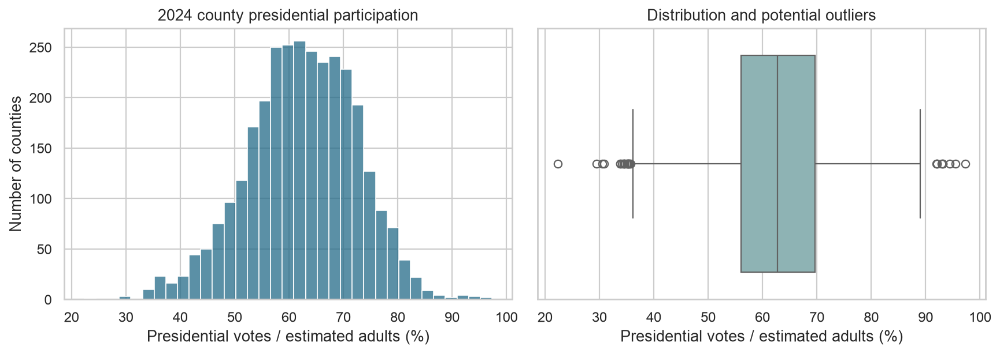
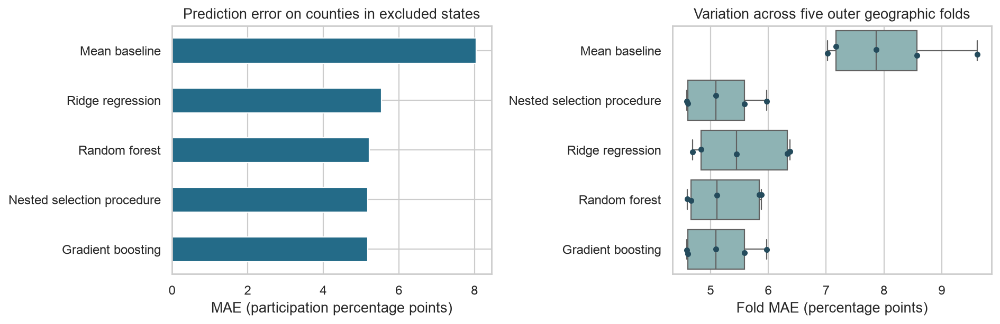

# Understanding county presidential participation

**Author:** Mikaela Beck  
**Final capstone:** Required Capstone Project 24.1  
**Analysis completed:** October 29, 2026

## Executive summary

This project examines why the measured rate of presidential participation differs across U.S. counties. It combines election returns with Census demographic estimates for **3,099 counties and county equivalents in 48 states and Washington, DC**. The final comparison tests predictions on states excluded from each round of model fitting and tuning.

The tested model-selection workflow misses the observed participation measure by **5.17 percentage points per county on average**, compared with **8.05 points** for a simple county-average prediction. That is a **35.7% reduction in average error**. The full-data search ultimately selects **Gradient boosting**. Performance is reported for the separately evaluated selection workflow, rather than for predictions made on the data used to fit that final model.

The outcome is **presidential votes per 100 estimated adult residents**, a participation proxy. It is not an official turnout rate among registered or eligible voters. The study describes aggregate relationships in 2024; it does not show that changing a demographic characteristic or campaign activity would cause turnout to change.

## Rationale

Election researchers, civic organizations, and public administrators need dependable measures before interpreting differences in participation. County boundaries, reporting jurisdictions, population estimates, and election dates can create apparent differences that are partly measurement problems. This project builds a transparent comparison and tests whether demographic and prior voting context improve on a single county-average benchmark.

A concrete lesson emerged during the final audit: Kansas City and the rest of Jackson County, Missouri report through separate election boards. The initial draft omitted the city jurisdiction when constructing the county total. Correcting that preparation error adds **124,288 presidential votes in 2024** and **136,645 in 2020** to the corresponding Jackson County records. Reliable geographic preparation matters before interpreting any model result.

## Research question

The original proposal asked: **Which demographic, political, and campaign-context factors are most predictive of voter turnout in U.S. elections?**

The final operational question is: **How well can county demographic and prior presidential voting patterns explain variation in 2024 presidential participation across counties in different states?**

This report completes that narrower retrospective analysis. It does not claim to explain the effects of campaign spending or direct voter contact. Those variables were proposed earlier but could not be incorporated with a defensible county-level definition in the available dataset.

## Data sources

| Source | Information used | Period |
|---|---|---|
| [MIT Election Data and Science Lab](https://doi.org/10.7910/DVN/VOQCHQ), accessed through the [Election Data public mirror](https://electiondata.dev/datasets/county-president/) | Presidential vote counts and prior two-party voting patterns | 2024 outcome; 2020 political context |
| [U.S. Census Bureau ACS](https://www.census.gov/programs-surveys/acs/data/data-via-api.html), accessed through [Census Reporter](https://censusreporter.org/about/) | Population, age, household income, education, and poverty | 2020–2024 five-year estimates |
| [Kansas City Election Board](https://kceb.org/board/faq/) and [Jackson County Election Board](https://jcebmo.org/election-information/jurisdiction/) | Official descriptions establishing that the two reporting jurisdictions cover separate parts of Jackson County | Checked October 29, 2026 |

Raw observations are preserved locally with their source versions, retrieval dates, and checksums in [the source manifest](data/raw/sources.json). Election CSVs match the files in the published Module 20 upload. The Census response is the same preserved snapshot, recompressed for this package. The election mirror has not been independently compared with a direct Harvard raw datafile; that remains a source-validation limitation.

## Methodology

### What is being predicted

The participation measure divides 2024 presidential votes by the estimated population age 18 or older, then multiplies by 100. A value of 65 means approximately 65 presidential votes for every 100 estimated adult residents. The denominator includes noncitizens and other adults who may be ineligible to vote. It is a five-year population estimate, not a count of eligible residents on election day. The numerator excludes ballots without a presidential vote.

### Preparing the data

County records are joined using five-digit county identifiers. Each reported vote total is counted once, rather than repeated for every candidate. Kansas City's separately reported votes are combined with the rest of Jackson County in both election years, using the boards' stated jurisdictions. The corrected 2024 county total is **318,017 presidential votes**, giving a participation proxy of **57.59%**.

Alaska's election districts and Connecticut's changed county-equivalent geography are excluded because the source geographies do not match directly. Five additional counties have proxy values above 100% and are excluded from the bounded-outcome analysis, with their original observations retained in the audit. These ratios can reflect incompatibility or uncertainty in population estimates and vote counts; they are not evidence of improper voting. Valid but unusual observations remain in the analysis. **1 missing predictor value** is handled within each training fold.

The eight model inputs describe county size; residents age 18–29 and 65+; household income; college attainment; poverty; and 2020 two-party share and competitiveness. Race/ethnicity shares are excluded from final modeling. Prior turnout, urban/rural classification, FEC spending, and clustering are documented as scope changes or future extensions, rather than reported as completed analyses.

### Comparing and tuning models

This is supervised regression: the models learn from counties with a known continuous participation measure. Ridge regression represents a regularized linear relationship. Random forest and gradient boosting can capture more complex patterns. A simple benchmark predicts the training counties' average participation for every county being tested.

The final evaluation uses five rounds of testing on excluded states. In each round, a three-fold search within the remaining states compares **21 model-and-setting combinations**. It chooses a model and settings without using that round's excluded-state outcomes. Every county receives one prediction from a model that was not fitted or tuned on its state. Missing-value handling and scaling are also learned within the training folds. After evaluation, a separate grouped search on all counties chooses the final fitted model.

The main score is **average absolute error in participation percentage points**. It is directly interpretable: a five-point error means a predicted rate of 65 when the measured rate is 60, or vice versa. Each county receives equal weight. A second score, root mean squared error, places more emphasis on large misses. The technical notebook also reports R²; it is not a percentage of individual voters predicted correctly.

## Results

### Measured participation varies substantially

The average county proxy is **62.50%** and the median is **62.78%**. The middle half of counties range from **56.10% to 69.64%**. The ratio of all votes to all estimated adults in the matched sample is **59.36%**. The county average and aggregate ratio answer different questions; neither is an official national turnout statistic.

The strongest simple rank associations among the final inputs are summarized below. They describe how counties vary together, without holding other characteristics constant.

| County characteristic | Observed association |
|---|---|
| Residents below poverty threshold (%) | Lower participation proxy |
| Residents age 18–29 (%) | Lower participation proxy |
| Residents age 65+ (%) | Higher participation proxy |
| Median household income (2024 dollars) | Higher participation proxy |

These are aggregate associations, not conclusions about how individuals behave or how an intervention would affect participation.

### Models improve on the county-average benchmark

| Model or workflow | Average absolute error in percentage points | Error emphasizing large misses in percentage points |
|---|---:|---:|
| Mean baseline | 8.05 | 10.08 |
| Ridge regression | 5.54 | 7.10 |
| Random forest | 5.22 | 6.67 |
| Gradient boosting | 5.17 | 6.59 |
| Nested selection procedure | 5.17 | 6.59 |

The **nested selection procedure** is the main result: its model family and settings are selected inside each training round. The family-specific rows show how each separately tuned approach performed. They are not used to pick a new winner after seeing the test outcomes.

Gradient boosting was selected in all five outer training searches. Its average error is close to random forest's, so the small gap should not be interpreted as definitive evidence that one family will always perform better.

An average miss of **5.17 points** is useful progress relative to the benchmark, but still leaves meaningful unexplained variation. Results vary by state and county. The technical notebook includes residual plots and state-level error tables so that this variation is visible.

Measurement problems are particularly relevant for very small counties. In the **41 counties with fewer than 1,000 estimated adults**, average error is **9.96 points**, compared with **5.11** in the remaining counties. This descriptive check supports extra scrutiny of population denominators; it does not establish why the errors occur.

The overall average also hides geographic failures. **Hawaii has 21.57-point average error across 4 included counties**, the largest state-level error in this evaluation and worse than its **14.29-point baseline error**. A good national average does not establish reliable performance in every state. This is a reason to inspect local errors and unmeasured state context before considering any operational use, rather than retuning on the same excluded-state outcomes.

### Important predictive relationships and uncertainty

The workflow relies most on **residents age 18–29 (%), residents age 65+ (%), adults 25+ with bachelor degree or higher (%)**, according to how much prediction error increases when each feature is shuffled within the excluded states. This describes reliance for prediction; it does not establish that any characteristic causes higher or lower participation. Related inputs can share or mask predictive importance.

Resampling whole states gives an approximate 95% geographic range of **4.70–5.63 points** for the workflow's average error. The corresponding range for the benchmark-minus-workflow improvement is **2.27–3.48 points**. These ranges describe sensitivity to the geographic mix of the saved predictions. They do not include Census sampling uncertainty or uncertainty from refitting every model search.

### Limits on what the findings establish

This is an exploratory study of one election, with demographic estimates released after that election. The original Module 20 results informed the final feature choice; the earlier test set is not presented as untouched confirmation. Grouped nested validation tests transfer across states within 2024, not a future-election forecast. The use of estimated adult population, excluded geographies, source vote discrepancies, and different county sizes all limit generalization. No causal effect or financial return from campaign activity is estimated.

## Recommendations and next steps

**For election-data preparation:** use a documented jurisdiction checklist before treating any source row as a complete county. Apply the Jackson/Kansas City correction consistently to future updates and retain the original source rows and geographic audit.

**For participation reporting:** validate the denominator against election-year eligible or registered populations where available. Show measurement limitations alongside comparisons, particularly for very small counties and mismatched reporting areas.

**For model use:** retain this work as a transparent retrospective research benchmark. Review state-level errors and source anomalies before using model outputs in substantive decisions. Predictive importance should not be translated into claims that changing a feature or outreach activity will cause participation to rise.

**For the next analytical phase:** assemble multiple election cycles and demographic releases available before each election, then test chronologically before making forecasting claims. Add prior turnout only with year-appropriate denominators. Incorporate campaign spending only after defining the financial concept and its geographic allocation. County clustering can be explored later for a separate descriptive question.

## Outline of project

1. [Data preparation and EDA notebook](notebooks/01_data_preparation_eda.ipynb)
2. [Model selection and evaluation notebook](notebooks/02_model_selection_and_evaluation.ipynb)
3. [Technical notes and exact fitted settings](reports/technical_notes.md)
4. [Processed analytical dataset](data/processed/county_analysis.csv) and [data dictionary](data/processed/data_dictionary.csv)
5. [Nested model comparison](reports/nested_model_comparison.csv), [predictions](reports/out_of_fold_predictions.csv), and [grid-search results](reports/nested_grid_search_results.csv)
6. [Geographic correction](reports/jackson_county_harmonization.csv), [cleaning audit](reports/cleaning_audit.json), and [excluded counties](reports/excluded_counties.csv)
7. [Final rubric checklist](reports/rubric_checklist.md)

### Reproducing the work

Use Python 3.12 and install the packages in `requirements.txt`. Open the notebooks from the project folder and run Notebook 01, then Notebook 02, from fresh kernels. Local raw snapshots are included, so no API keys or fresh downloads are required. Notebook 02 performs the full grouped searches and may take several minutes. It regenerates all modeling reports. The notebooks already contain executed outputs for review.

The original Module 20 upload is preserved at [commit 8ca462f](https://github.com/MikCB/capstone-20/tree/8ca462f0b2f3b852a06df3bd2c165066591aa0e0/county-turnout-capstone). This final package is separate so earlier work is not overwritten.

### Contact and further information

Author: Mikaela Beck. Source provenance, transformations, fitted settings, and limitations are documented in the linked notebooks and supporting reports.
